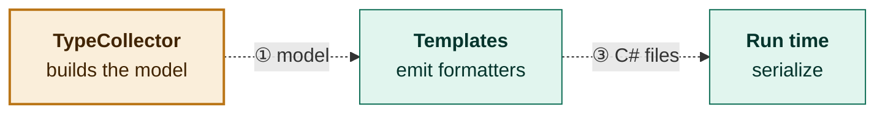
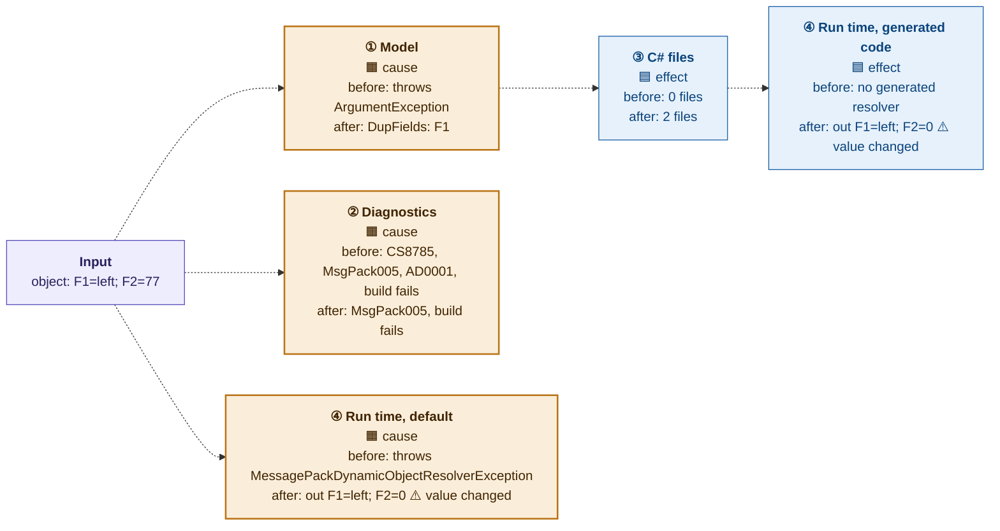
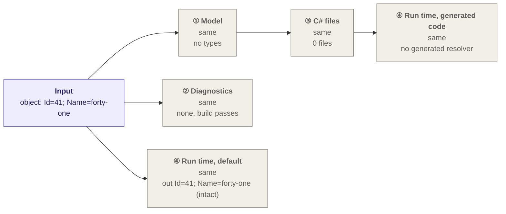
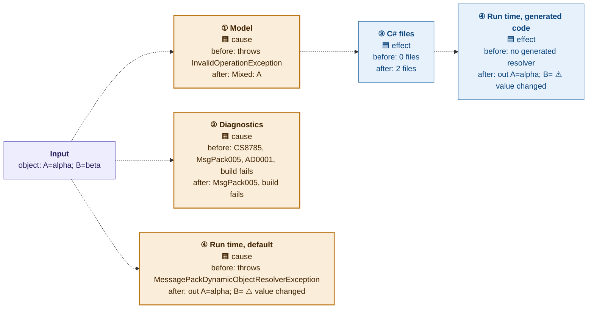

<!-- review-map:v1 -->
## Review map · `ju26-issue-2234`

> [!CAUTION]
> **Reduced confidence:** Built with .NET SDK 9.0.301, but the repo pins 8.0.402 (rollForward patch); the pin was overridden for this run. Compiler and analyzer behaviour can differ between SDKs.

**At a glance:** ⚠️ 2 warnings · ℹ️ 2 notes · 🤔 1 decision for you · ⬜ 4 not checked
<sub>Computed from the runs: 4/8 new tests fail without the PR · 18/18 changed lines ran · a known break shows in 3/6 inputs</sub>

Duplicate or mixed keys no longer crash the type collector; it now keeps one member. The kept formatter silently loses the second member's value.

### 🔍 What it found

**1. ⚠️ 4 of 8 new tests also pass on the old code, so they do not test this change: `AllowPrivateRequiredIsReported`, `MemberTypeMustBeMessagePackObjectIsReported`, `MemberWithoutKeyIsReported`, `SourceGenerationOnlyDiagnosticsAreNotReportedWhenSuppressed`.** <sub>🤖 computed by the script</sub>

**2. ⚠️ A duplicate key now compiles into a formatter that drops data**

```diff
@@ generated-dup-string-keys-fields · ③ C# files @@
- before: 0 files
+ after:  2 files
@@ generated-dup-string-keys-fields · ④ Run time, generated code @@
+ after:  out F1=left; F2=0 ⚠️ value changed
```
<sub>Full trace: [`generated-dup-string-keys-fields`](#user-content-trace-generated-dup-string-keys-fields)</sub>

**3. ℹ️ Code-only warning: the guard skips a colliding member.**

[TypeCollector.cs lines 1023–1026](https://github.com/ZeynelAbidin91/junction26-messagepack-csharp/blob/9007cee1163c4a274fd60c3cc20c21ae63622786/src/MessagePack.SourceGenerator/CodeAnalysis/TypeCollector.cs#L1023-L1026)
```csharp
if (!intMembers.ContainsKey(member.IntKey))
{
    intMembers.Add(member.IntKey, (member, item.Type));
}
```

**4. ℹ️ Valid types are unaffected. The control input behaves the same on both sides.**

```diff
@@ suppressed-valid-control · ④ Run time, default @@
  same before and after: out Id=41; Name=forty-one (intact)
```
<sub>Full trace: [`suppressed-valid-control`](#user-content-trace-suppressed-valid-control)</sub>

### 🤔 Decisions for you

**1. Is "first member wins" acceptable for duplicate keys?** · `trade-off` · owner: unassigned <sub>(set the repository variable `REVIEW_MAP_OWNERS`)</sub>

> **Why the AI didn't decide:** The generator now emits a formatter that keeps the first member; MsgPack005 still fails the build.
> **What would settle it:** A maintainer decision on generator behaviour for invalid types.
> **Options:** (a) Keep it while MsgPack005 stays an error · (b) Skip invalid types in the generator

<details>
<summary>Evidence</summary>

```diff
@@ generated-dup-string-keys-fields · ④ Run time, generated code @@
+ after:  out F1=left; F2=0 ⚠️ value changed
```
<sub>Full trace: [`generated-dup-string-keys-fields`](#user-content-trace-generated-dup-string-keys-fields)</sub>

</details>

<sub>Reasons come from a fixed list: `intent` the requirement does not say · `trade-off` a policy call with no technically right answer · `unreproduced` the reported bug never showed before the change · `out-of-reach` the tools here cannot run it.</sub>

### ⬜ What it did not check

| What | Why not | Risk if wrong | How to check |
|---|---|---|---|
| What [TypeCollector.cs 1039–1042](https://github.com/ZeynelAbidin91/junction26-messagepack-csharp/blob/9007cee1163c4a274fd60c3cc20c21ae63622786/src/MessagePack.SourceGenerator/CodeAnalysis/TypeCollector.cs#L1039-L1042) does <sub>🤖</sub> | removing it from the PR changes nothing in any input that ran, so no input shows what it does (the lines may still run, with the same result either way) | whatever this part changes is not shown anywhere in this review | add an input whose result differs with and without these lines, or a test that fails without them |
| What [TypeCollector.cs 1163–1166](https://github.com/ZeynelAbidin91/junction26-messagepack-csharp/blob/9007cee1163c4a274fd60c3cc20c21ae63622786/src/MessagePack.SourceGenerator/CodeAnalysis/TypeCollector.cs#L1163-L1166) does <sub>🤖</sub> | removing it from the PR changes nothing in any input that ran, so no input shows what it does (the lines may still run, with the same result either way) | whatever this part changes is not shown anywhere in this review | add an input whose result differs with and without these lines, or a test that fails without them |
| 7 other test projects: `MessagePack.AspNetCoreMvcFormatter.Tests`, `MessagePack.Experimental.Tests`, `MessagePack.GeneratedCode.Tests`, `MessagePack.Internal.Tests`, `MessagePack.SourceGenerator.ExecutionTests` (changed by this PR), `MessagePack.SourceGenerator.MapModeExecutionTests`, `MessagePack.Tests` <sub>🤖</sub> | only `MessagePack.SourceGenerator.Tests.csproj` was run | this PR changes files in some of them, so their results matter | dotnet test tests/MessagePack.SourceGenerator.ExecutionTests/MessagePack.SourceGenerator.ExecutionTests.csproj |
| Map-mode execution | no scenario uses map mode at run time | string-keyed types behave differently | run MessagePack.SourceGenerator.MapModeExecutionTests |

<sub>🤖 added by the script from coverage, the requirement map and the extra builds.</sub>

### ❌ Not backed by the evidence (6)

The reviewer wrote these, but what it pointed to does not exist or shows something else. Treat them as unchecked opinions.

- **Summary:** PLANTED: a sentence with no evidence at all.<br><sub>cites no evidence</sub>
- **Found:** PLANTED: wrong direction. Claims the suppressed duplicate-int case now generates files.<br><sub>cited as a difference, but ③ C# files is identical before and after. The runs show: `suppressed-dup-int-keys` ③ C# files: `0 files` on both sides</sub>
- **Unit TypeCollector member collection:** PLANTED: cites a scenario that never ran.<br><sub>scenario `no-such-scenario` did not run</sub>
- **Claims:** "PLANTED: all tests pass" (verified)<br><sub>no test called `all 170 tests passed` ran</sub>
- **Claims:** "PLANTED: private required members are newly reported" (verified)<br><sub>cited as fails-before-passes-after, but the recorded outcome is passes-both. The runs show: test `SuppressSourceGenerationAnalyzerTests.AllowPrivateRequiredIsReported`: before Passed → after Passed</sub>
- **Claims:** "PLANTED: malformed pointer" (verified)<br><sub>malformed pointer `run:generated-dup-string-keys-fields:model`: expected run:<scenario>:<handoff>:<side>:<expects></sub>

### 🧩 Which part of the change causes what

<sub>The script rebuilt the PR with one part removed at a time and ran every input through it (6 builds). A part **causes** an effect when removing it brings the old value back.</sub>

- [TypeCollector.cs 1008](https://github.com/ZeynelAbidin91/junction26-messagepack-csharp/blob/9007cee1163c4a274fd60c3cc20c21ae63622786/src/MessagePack.SourceGenerator/CodeAnalysis/TypeCollector.cs#L1008) → **causes** [`mixed-keys-props-int-first`](#user-content-trace-mixed-keys-props-int-first) ①②③④

  ```diff
  @@ TypeCollector.cs 1008 @@
  + continue; // The key kind does not match the other members; the diagnostic is reported, so skip this member.
  ```

- [TypeCollector.cs 1023–1026](https://github.com/ZeynelAbidin91/junction26-messagepack-csharp/blob/9007cee1163c4a274fd60c3cc20c21ae63622786/src/MessagePack.SourceGenerator/CodeAnalysis/TypeCollector.cs#L1023-L1026) → **causes** [`suppressed-dup-int-keys`](#user-content-trace-suppressed-dup-int-keys) ①②

  ```diff
  @@ TypeCollector.cs 1023–1026 @@
  + if (!intMembers.ContainsKey(member.IntKey))
  + {
  +     intMembers.Add(member.IntKey, (member, item.Type));
  + }
  ```

- [TypeCollector.cs 1039–1042](https://github.com/ZeynelAbidin91/junction26-messagepack-csharp/blob/9007cee1163c4a274fd60c3cc20c21ae63622786/src/MessagePack.SourceGenerator/CodeAnalysis/TypeCollector.cs#L1039-L1042) → **no effect in any input** (nothing here shows what it changes)

  ```diff
  @@ TypeCollector.cs 1039–1042 @@
  + if (!stringMembers.ContainsKey(member.StringKey))
  + {
  +     stringMembers.Add(member.StringKey, (member, item.Type));
  + }
  ```

- [TypeCollector.cs 1148](https://github.com/ZeynelAbidin91/junction26-messagepack-csharp/blob/9007cee1163c4a274fd60c3cc20c21ae63622786/src/MessagePack.SourceGenerator/CodeAnalysis/TypeCollector.cs#L1148) → **causes** [`mixed-keys-fields-string-first`](#user-content-trace-mixed-keys-fields-string-first) ①②③④

  ```diff
  @@ TypeCollector.cs 1148 @@
  + continue; // The key kind does not match the other members; the diagnostic is reported, so skip this member.
  ```

- [TypeCollector.cs 1163–1166](https://github.com/ZeynelAbidin91/junction26-messagepack-csharp/blob/9007cee1163c4a274fd60c3cc20c21ae63622786/src/MessagePack.SourceGenerator/CodeAnalysis/TypeCollector.cs#L1163-L1166) → **no effect in any input** (nothing here shows what it changes)

  ```diff
  @@ TypeCollector.cs 1163–1166 @@
  + if (!intMembers.ContainsKey(member.IntKey))
  + {
  +     intMembers.Add(member.IntKey, (member, item.Type));
  + }
  ```

- [TypeCollector.cs 1179–1182](https://github.com/ZeynelAbidin91/junction26-messagepack-csharp/blob/9007cee1163c4a274fd60c3cc20c21ae63622786/src/MessagePack.SourceGenerator/CodeAnalysis/TypeCollector.cs#L1179-L1182) → **causes** [`generated-dup-string-keys-fields`](#user-content-trace-generated-dup-string-keys-fields) ①②③④

  ```diff
  @@ TypeCollector.cs 1179–1182 @@
  + if (!stringMembers.ContainsKey(member.StringKey))
  + {
  +     stringMembers.Add(member.StringKey, (member, item.Type));
  + }
  ```


### 🗺️ The change as a pipeline



<sub>🟧 changed by this PR · 🟩 code untouched, behaviour changes · ⬜ unchanged · dashed arrow: the data on that hand-off changes</sub>

### 🔬 Follow one real input through the pipeline

<sub>Each input ran on the code before and after this PR. Each box shows what crossed that hand-off; 🟧 is where a difference starts, 🟦 what follows from it. Values are copied from the runs by a script.</sub>

<a name="trace-generated-dup-string-keys-fields"></a>

<details open>
<summary><b>Two fields share a string key</b></summary>



<details>
<summary>The input as C#</summary>

```csharp
// ---- your project
using MessagePack;
namespace App;
[MessagePackObject]
public class DupFields
{
    [Key("a")]
    public string F1;
    [Key("a")]
    public int F2;
}
```

</details>

<details>
<summary>Full values at each hand-off</summary>

| Hand-off | Before this PR | After this PR |
|---|---|---|
| ① Model out of TypeCollector<br>🟧 **cause** | throws `ArgumentException` | `App.DupFields`: F1 (key "a", String) |
| ② Diagnostics out<br>🟧 **cause** | warning `CS8785`<br>error `MsgPack005` at App.cs:9<br>warning `AD0001`<br>**build fails** | error `MsgPack005` at App.cs:9<br>**build fails** |
| ③ C# files out of the templates<br>🟦 effect | 0 files | 2 files: `ProbeResolver`, `DupFieldsFormatter` |
| ④ Run time, default options<br>🟧 **cause** | throws `MessagePackDynamicObjectResolverException`<br>key is duplicated, all members key must be unique. Member: F2<br><sub>the build fails first, so this cannot ship</sub> | in `F1=left; F2=77`<br>wire `{"a":"left"}` (8 bytes)<br>out `F1=left; F2=0`<br>⚠️ **a value changed on the way**<br><sub>the build fails first, so this cannot ship</sub> |
| ④ Run time, generated resolver first<br>🟦 effect | no generated resolver exists to use | in `F1=left; F2=77`<br>wire `{"a":"left"}` (8 bytes)<br>out `F1=left; F2=0`<br>⚠️ **a value changed on the way**<br><sub>the build fails first, so this cannot ship</sub> |

Scenario `generated-dup-string-keys-fields`. Re-run it yourself and compare with this table:

```bash
node review.mjs replay --from out/local-2234 --scenario generated-dup-string-keys-fields --repo <checkout of 9007cee1>
```

</details>

① the model keeps F1 only, so ③ emits a formatter for one member and ④ reads F2 back as 0.

</details>

<a name="trace-suppressed-valid-control"></a>

<details>
<summary><b>Control: valid suppressed type with int keys should be unaffected and use the dynamic resolver</b></summary>



<details>
<summary>The input as C#</summary>

```csharp
// ---- your project
using MessagePack;
namespace App;
[MessagePackObject(SuppressSourceGeneration = true)]
public class Plain
{
    [Key(0)]
    public int Id { get; set; }
    [Key(1)]
    public string Name { get; set; }
}
```

</details>

<details>
<summary>Full values at each hand-off</summary>

| Hand-off | Before this PR | After this PR |
|---|---|---|
| ① Model out of TypeCollector<br>same | no types collected | no types collected |
| ② Diagnostics out<br>same | none<br>build passes | none<br>build passes |
| ③ C# files out of the templates<br>same | 0 files | 0 files |
| ④ Run time, default options<br>same | in `Id=41; Name=forty-one`<br>wire `[41,"forty-one"]` (12 bytes)<br>out `Id=41; Name=forty-one`<br>round trip intact | in `Id=41; Name=forty-one`<br>wire `[41,"forty-one"]` (12 bytes)<br>out `Id=41; Name=forty-one`<br>round trip intact |
| ④ Run time, generated resolver first<br>same | no generated resolver exists to use | no generated resolver exists to use |

Scenario `suppressed-valid-control`. Re-run it yourself and compare with this table:

```bash
node review.mjs replay --from out/local-2234 --scenario suppressed-valid-control --repo <checkout of 9007cee1>
```

</details>

Shows that a valid suppressed type yields the same model, no diagnostics and the same dynamic round-trip before and after, with no generated formatter.

</details>

<a name="trace-mixed-keys-props-int-first"></a>

<details>
<summary><b>Properties with an int key followed by a string key (mixed kinds, MsgPack005)</b></summary>



<details>
<summary>The input as C#</summary>

```csharp
// ---- your project
using MessagePack;
namespace App;
[MessagePackObject]
public class Mixed
{
    [Key(0)]
    public string A { get; set; }
    [Key("b")]
    public string B { get; set; }
}
```

</details>

<details>
<summary>Full values at each hand-off</summary>

| Hand-off | Before this PR | After this PR |
|---|---|---|
| ① Model out of TypeCollector<br>🟧 **cause** | throws `InvalidOperationException` | `App.Mixed`: A (key 0, String) |
| ② Diagnostics out<br>🟧 **cause** | warning `CS8785`<br>error `MsgPack005` at App.cs:8<br>warning `AD0001`<br>**build fails** | error `MsgPack005` at App.cs:8<br>**build fails** |
| ③ C# files out of the templates<br>🟦 effect | 0 files | 2 files: `ProbeResolver`, `MixedFormatter` |
| ④ Run time, default options<br>🟧 **cause** | throws `MessagePackDynamicObjectResolverException`<br>all members key type must be same. Member: B<br><sub>the build fails first, so this cannot ship</sub> | in `A=alpha; B=beta`<br>wire `["alpha"]` (7 bytes)<br>out `A=alpha; B=`<br>⚠️ **a value changed on the way**<br><sub>the build fails first, so this cannot ship</sub> |
| ④ Run time, generated resolver first<br>🟦 effect | no generated resolver exists to use | in `A=alpha; B=beta`<br>wire `["alpha"]` (7 bytes)<br>out `A=alpha; B=`<br>⚠️ **a value changed on the way**<br><sub>the build fails first, so this cannot ship</sub> |

Scenario `mixed-keys-props-int-first`. Re-run it yourself and compare with this table:

```bash
node review.mjs replay --from out/local-2234 --scenario mixed-keys-props-int-first --repo <checkout of 9007cee1>
```

</details>

Shows the new `continue` on mixed key kinds, so the model and generated code drop B after the change while the diagnostic is still reported.

</details>

### More detail

<details>
<summary><b>🧪 Tests</b>: 171/175 pass before, 175/175 pass after · 4 of 8 new tests fail without the PR · 18/18 changed lines ran</summary>

`tests/MessagePack.SourceGenerator.Tests/MessagePack.SourceGenerator.Tests.csproj`. Before: source files reverted, the PR's tests kept.

| New test | Before | After | What it shows |
|---|---|---|---|
| `SuppressSourceGenerationAnalyzerTests.DuplicateIntKeysAreReportedWithoutAnalyzerFailure` | Failed | Passed | ✅ fails before, passes after |
| `SuppressSourceGenerationAnalyzerTests.DuplicateKeysAreReportedWithoutAnalyzerFailureForGeneratedTypes` | Failed | Passed | ✅ fails before, passes after |
| `SuppressSourceGenerationAnalyzerTests.DuplicateStringKeysAreReportedWithoutAnalyzerFailure` | Failed | Passed | ✅ fails before, passes after |
| `SuppressSourceGenerationAnalyzerTests.MixedKeyKindsAreReportedWithoutAnalyzerFailure` | Failed | Passed | ✅ fails before, passes after |
| `SuppressSourceGenerationAnalyzerTests.AllowPrivateRequiredIsReported` | Passed | Passed | ⚠️ passes before too: does not test this change |
| `SuppressSourceGenerationAnalyzerTests.MemberTypeMustBeMessagePackObjectIsReported` | Passed | Passed | ⚠️ passes before too: does not test this change |
| `SuppressSourceGenerationAnalyzerTests.MemberWithoutKeyIsReported` | Passed | Passed | ⚠️ passes before too: does not test this change |
| `SuppressSourceGenerationAnalyzerTests.SourceGenerationOnlyDiagnosticsAreNotReportedWhenSuppressed` | Passed | Passed | ⚠️ passes before too: does not test this change |

Changed lines that ran: 18 of 18 (10 by an input, 13 by a test); 4 removed lines are checked by the before side only.

</details>

<details>
<summary><b>🔧 Units, input to output</b> (1)</summary>

**TypeCollector member collection** · changed by this PR

- **Receives:** a type symbol
- **Emits:** the model
- **What changed:** skips a member whose key is taken

_Mixed keys: the collector used to throw, now keeps A._

```diff
@@ mixed-keys-props-int-first · ① Model @@
- before: throws InvalidOperationException
+ after:  Mixed: A
```

</details>

<details>
<summary><b>📝 The author's claims, checked</b>: 1 hold, 1 need you, 1 hold in the code only</summary>

**✅ Holds:** Duplicate int keys are reported without an analyzer failure <sub>(test name)</sub>

The new test fails on the old code and passes now.

```diff
@@ test SuppressSourceGenerationAnalyzerTests.DuplicateIntKeysAreReportedWithoutAnalyzerFailure @@
- before: Failed
+ after:  Passed
```

**🔎 Holds in the code, not run:** A colliding member is skipped rather than added <sub>(code comment)</sub>

The guard is in the code.

[TypeCollector.cs lines 1023–1026](https://github.com/ZeynelAbidin91/junction26-messagepack-csharp/blob/9007cee1163c4a274fd60c3cc20c21ae63622786/src/MessagePack.SourceGenerator/CodeAnalysis/TypeCollector.cs#L1023-L1026)
```csharp
if (!intMembers.ContainsKey(member.IntKey))
{
    intMembers.Add(member.IntKey, (member, item.Type));
}
```

**⚠️ Not verified:** Fixes the issue's main symptom <sub>(PR title)</sub>

No scenario reproduces the issue's report.

</details>

<details>
<summary><b>⚙️ How this was checked</b></summary>

- 6 scenarios chosen by the reviewing agent from the diff and the issue, each run through the real generator, analyzer and run-time serializer on both sides.
- `tests/MessagePack.SourceGenerator.Tests/MessagePack.SourceGenerator.Tests.csproj` on both sides. After: 175 passed, 0 failed. Before (source files reverted, the PR's tests kept): 171 passed, 4 failed. 4 tests changed outcome.
- Built with .NET SDK 9.0.301 on win32 (the repo pins 8.0.402).
- Reviewing agent: `fixture (hand-written agent output with planted mistakes)`, two calls (choose inputs, requirements and the expected symptom; explain the evidence). It cites evidence as pointers; every value quoted next to its words, the trace tables, the cause and effect tags, the test verdicts, the coverage and the rule-made decisions are computed by a script from the recorded runs.
- Can the probe see a break? A known break (TypeCollector drops the first member of every type it collects) showed in 3 of 6 inputs, at ① Model, ③ C# files, ④ Run time, default, ④ Run time, generated code. It did not show in `suppressed-valid-control`, `suppressed-unkeyed-member`, `suppressed-dup-int-keys`, so for those inputs "no difference" says less.

**Reviewer verdicts the script downgraded**
- "Code-only warning: the guard skips a colliding member.": marked WARNING, but no run or test shows it, so it is shown as a note
- R2: marked met, but no run or test shows it, so it is shown as not shown
- "A colliding member is skipped rather than added": marked verified, but its evidence is only code reading, so it is shown as "holds in the code, not run"

</details>

<sub>Review map for `9007cee1` against `32258fdb`. Generated automatically by review-map with `fixture (hand-written agent output with planted mistakes)`, which did not write this change.</sub>

<sub>Evidence, SHA-256: scenarios.json `c2fbcab67f23f154` · probe-before.json `97a011b1176250cf` · probe-after.json `d2772dae854d2e00` · probe-mutant.json `7b97588f063504ea` · tests.json `1e0a06c2bff999d7` · probe-without-H1.json `6b01167d372b2049` · probe-without-H2.json `3c78265577dfa785` · probe-without-H3.json `d2772dae854d2e00` · probe-without-H4.json `c9eab84efd7c9a60` · probe-without-H5.json `d2772dae854d2e00` · probe-without-H6.json `5d9b8f9df09eb5da`</sub>
